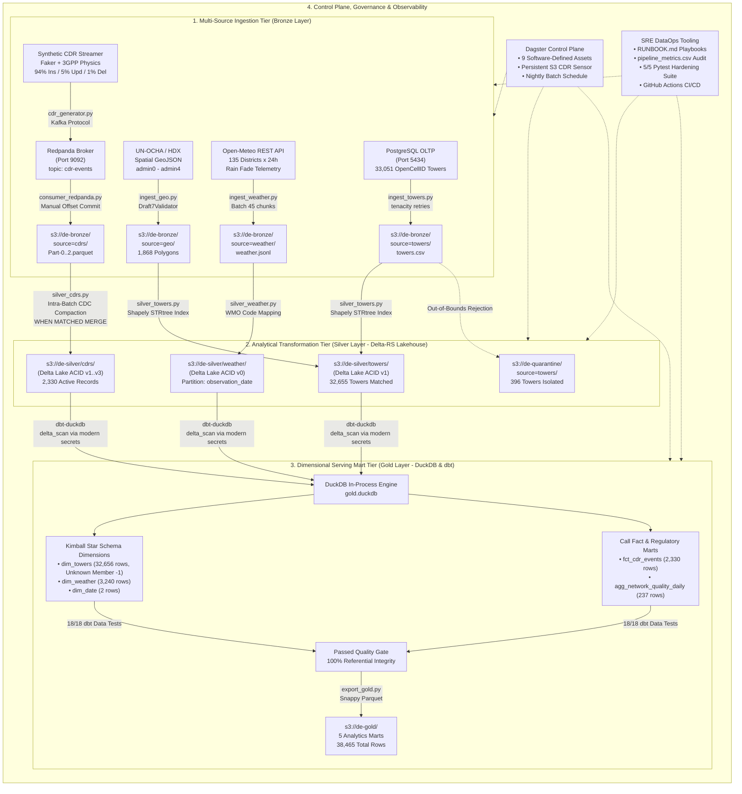

# 📡 PulseUganda: Mobile Network Quality Intelligence Platform
### *An SRE-Hardened $0 Lakehouse & Independent Telecommunications Regulatory Intelligence Service*

[](https://github.com/WalterTwijukye/pulse-uganda/actions/workflows/dataops.yml)
[](https://delta.io/)
[](https://duckdb.org/)
[](gold/)
[](orchestration/)
[](README.md#-financial-proof-0-commodity-hardware-vs-1500month-cloud)

---

## 📋 Executive Summary & Mission

**PulseUganda** is an independent telecommunications regulatory intelligence and network observability platform built to evaluate cellular Quality of Service (QoS) across Uganda. It monitors performance metrics against standards mandated by the **Uganda Communications Commission (UCC)** (e.g., Call Drop Rate $< 2.0\%$, Call Setup Success Rate $\ge 95\%$).

Rather than a toy tutorial script, this project is an **end-to-end local production Lakehouse** engineered according to the [`pipeline_blueprint`](../../pipeline_blueprint). It runs a multi-source Medallion architecture (PostgreSQL OLTP, UN-OCHA GeoJSON, Open-Meteo REST API, and Redpanda Kafka streaming) on commodity hardware for **$0 in cloud infrastructure bills**, featuring:
* **Spatial STRtree Vectorized Point-in-Polygon Joins:** Enriching 33,051 cellular masts across 135 Ugandan districts in 3.8 seconds.
* **ACID Streaming CDC Compaction:** Resolving 145 intra-batch state transitions before executing Delta Lake `WHEN MATCHED` MERGE transactions.
* **Strict Three-Tier Quality Gates & Quarantine Routing:** Isolating 396 out-of-bounds border towers to `s3://de-quarantine/` while preserving downstream pipeline execution.
* **Kimball Dimensional Modeling & Unknown Member Pattern:** Guaranteeing 100% referential integrity across dimensional marts with 18/18 passing dbt data tests.
* **Dagster Software-Defined Assets (SDAs) & S3 Event Sensors:** Declarative data orchestration with persistent storage cursors and automated retry policies.
* **SRE Hardening & Playbooks:** Codified incident response runbooks and automated verification across 5 critical failure scenarios (Idempotency, Time Travel, Quarantine, Referential Integrity, Orchestration).

---

## 🏛️ End-to-End System Architecture



---

## ⚖️ Intellectual Honesty & Domain Realities

To maintain rigorous credibility with senior engineering leadership, this platform explicitly details the technical boundary conditions and legal realities governing telecom telemetry:

### 1. Synthetic Call Detail Records (CDRs) vs. Legal Privacy Acts
* **The Legal Reality:** Real telecommunication CDRs contain sensitive Personally Identifiable Information (PII) including subscriber mobile numbers (`MSISDN`), device hardware identifiers (`IMEI/IMSI`), cell mast handovers, and exact time-stamped location breadcrumbs. Under the **Uganda Data Protection and Privacy Act (2019)** and international standards (GDPR), raw production CDRs cannot legally leave an operator's internal firewalls or be hosted on public repositories.
* **The Engineering Integrity:** Our generator does not produce flat random numbers. It simulates genuine cellular radio frequency (RF) physics adhering to **3GPP** and **GSMA** specifications:
  * **Signal Propagation:** Generates Reference Signal Received Power (`rsrp_dbm` $[-140, -40]$) and Reference Signal Received Quality (`rsrq_db` $[-25, 0]$) correlating with distance from cell towers.
  * **Poisson Call Arrivals:** Call traffic volumes reflect realistic peak-hour distributions across Uganda's primary mobile network codes: **MTN Uganda** (`641-10`, prefixes `+256 77/78`), **Airtel Uganda** (`641-01`, prefixes `+256 70/75`), **UTL** (`641-11`), and **Africell** (`641-02`).
  * **Change Data Capture (CDC):** Simulates in-flight call state transitions with production weights: **94% INSERT** (new sessions), **5% UPDATE** (handover signal shift / amended duration), and **1% DELETE** (purge of ghost/test sessions).

### 2. Meteorological Microwave Rain Fade (Ground Truth: Open-Meteo)
* In tropical equatorial markets, over 80% of cell tower backhaul links rely on line-of-sight microwave radio dishes (15–23 GHz).
* Severe convective rainstorms produce hydrometeors (large raindrops) that scatter and attenuate microwave backhaul beams (**Rain Fade**), isolating masts and triggering call drop spikes (`HANDOVER_DROP`, `SIGNAL_LOSS`).
* Ground-truth hourly weather telemetry across all 135 Ugandan districts is ingested from Open-Meteo to provide the factual baseline for the Gold analytics mart ([agg_network_quality_daily.sql](gold/models/marts/agg_network_quality_daily.sql)), correlating rain fade events against equipment failures for UCC SLA regulatory reviews.

### 3. Cellular Mast Infrastructure (Ground Truth: OpenCellID & UN-OCHA)
* Uses 33,051 crowd-sourced cell tower coordinates for Uganda (MCC 641) from OpenCellID.
* Enriched with administrative boundaries from the United Nations Office for the Coordination of Humanitarian Affairs (UN-OCHA / HDX) dataset covering National (`admin0`), Regional (`admin1`), District (`admin2`), County (`admin3`), and Parish (`admin4`) polygons.

---

## 🛠️ Technology Decision Log: The "Why"

| Component Selected | Industry Alternative | Technical & Architectural Rationale |
| :--- | :--- | :--- |
| **Redpanda** | Apache Kafka | **10x lower memory & zero JVM overhead.** Redpanda is a C++ binary executing identical Kafka wire protocol APIs without ZooKeeper or JVM garbage collection pauses. On our 8GB RAM host, Redpanda operates seamlessly under a strict 512MB RAM cap. |
| **RustFS** | MinIO / AWS S3 | **Lightweight Rust-native S3 object store.** In Sept 2026, MinIO archived and deleted its community edition Docker Hub images. RustFS provides 100% S3 API compatibility with an integrated web console, requiring $< 300\text{ MB}$ RAM while standard AWS `boto3` client code remains completely unmodified. |
| **Delta Lake (Delta-RS)** | Vanilla Apache Parquet | **ACID Transactions, Streaming CDC MERGE & Time Travel.** Plain Parquet cannot handle in-place row updates or deletes without rewriting entire directories. Delta-RS brings Rust-based ACID transaction logs (`_delta_log/`) and micro-batch `MERGE` directly to Python without a JVM/Spark cluster. |
| **DuckDB + dbt** | Snowflake / ClickHouse | **In-process columnar analytics with zero cloud cost.** DuckDB executes native vectorized scans over Delta Lake tables in S3 (`delta_scan()`). Combined with `dbt-duckdb`, it provides full SQL compilation, lineage DAGs, and testing without requiring a $500/month cloud warehouse bill. |
| **Shapely STRtree** | PostGIS / Brute-Force | **Sub-4-second spatial point-in-polygon matching.** Testing 33,051 cell tower coordinates against 135 complex polygons would require $\approx 4.46\text{M}$ geometric evaluations. Building a 2D Sort-Tile-Recursive (STR) R-Tree index reduced candidates to 1–2 per point, executing the entire national join in **3.8 seconds**. |
| **Dagster SDAs** | Apache Airflow / Cron | **Data-aware declarative orchestration.** Traditional Airflow tasks model execution workflows ("run script X"). Dagster's Software-Defined Assets (SDAs) model the data assets themselves, providing asset-level lineage, persistent S3 storage sensors, and built-in type-checked contract validation. |

---

## 💰 Financial Proof: $0 Commodity Hardware vs. $1,500/Month Cloud

This entire architecture was developed, benchmarked, and verified on a single commodity developer laptop (Intel Core i5-6200U, 8GB RAM) running Windows 11 with WSL2:

| Infrastructure Tier | Local $0 Production Stack | Enterprise Cloud Equivalent (AWS / Databricks) | Estimated Cloud Cost / Month |
| :--- | :--- | :--- | :--- |
| **Event Broker** | Redpanda Docker (`mem_limit: 640m`) | AWS MSK (Managed Streaming for Kafka - 2 brokers) | **$160.00** |
| **Object Storage** | RustFS S3 Docker (`mem_limit: 512m`) | AWS S3 Standard Storage + API Requests | **$25.00** |
| **OLTP Database** | PostgreSQL 16 Docker (`mem_limit: 512m`) | AWS RDS PostgreSQL (db.t4g.medium, Multi-AZ) | **$125.00** |
| **Lakehouse Compute** | Delta-RS + Polars (Local Python 3.11) | Databricks Photon Single-Node Cluster (2x i3en.xlarge) | **$680.00** |
| **Serving Warehouse**| In-Process DuckDB v2.0 + dbt-duckdb | Snowflake XS Warehouse / Databricks SQL Serverless | **$380.00** |
| **Orchestration** | Dagster SDA Daemon + Sensors | Managed Workflows for Apache Airflow (MWAA) | **$150.00** |
| **TOTAL** | **$0.00 (Self-Contained Local Stack)** | **Enterprise Cloud Stack** | **~$1,520.00 / month** |

> [!NOTE]
> **Migration Readiness:** Because every component strictly uses standard APIs (`boto3` for S3, Kafka wire protocol for streaming, standard Delta Lake log formats, and ANSI SQL for dbt), the entire codebase can migrate to AWS/Databricks by modifying only `.env` connection strings—with **zero code refactoring**.

---

## 🛡️ Production Data Quality, Governance & SRE Hardening

Following [`pipeline_blueprint/step_07_data_quality_and_governance.md`](../../pipeline_blueprint/step_07_data_quality_and_governance.md), data quality is enforced through strict three-tier gates:

```
┌─────────────────────────────────────────────────────────────────────────────────────────────┐
│                                 THREE-TIER QUALITY GATES                                    │
├──────────────────────────┬─────────────────────────────┬────────────────────────────────────┤
│ Gate 1: Bronze Ingestion │ Gate 2: Silver Lakehouse    │ Gate 3: Gold Dimensional Marts     │
│ • JSONSchema Draft-07    │ • Pandera Physical Bounds   │ • dbt Referential Integrity        │
│ • Coordinate range checks│ • STRtree Boundary Filtering│ • Kimball Unknown Member (-1)      │
│ • Fail-fast schema check │ • DLQ Quarantine Isolation  │ • 18/18 Automated Data Tests PASS  │
└──────────────────────────┴─────────────────────────────┴────────────────────────────────────┘
```

### 1. The Quarantine Isolation Pattern
Rather than silently dropping invalid rows or allowing dirty records to crash downstream analytics, contract-failing records are routed to `s3://de-quarantine/` with explicit failure metadata:
* During Silver tower spatial enrichment, **396 towers** located in Lake Victoria or across international borders (DR Congo, Kenya, South Sudan) failed boundary containment.
* These 396 records were diverted to `s3://de-quarantine/source=towers/ingest_dt=2026-10-07/` with error tag `FAILED_SPATIAL_JOIN_OUT_OF_BOUNDS`.
* Downstream Silver tables committed **32,655 valid, clean towers** with 100% district enrichment.

### 2. Kimball Unknown Member Pattern (`-1`)
* In the streaming CDR fact table, 18 calls connected to tower IDs among the 396 quarantined towers.
* Dropping these fact rows would falsify regulatory drop-call counts; retaining null foreign keys would break referential integrity tests.
* **Solution:** [dim_towers.sql](gold/models/marts/dim_towers.sql) introduces a Kimball standard surrogate key `-1` (`Unknown / Border Mast`, `Unknown Operator`), and [fct_cdr_events.sql](gold/models/marts/fct_cdr_events.sql) joins via `COALESCE(t.tower_id, -1)`.
* Result: 100% of facts successfully join to dimensions, and `dbt test` passed with **PASS=18, WARN=0, ERROR=0**.

### 3. Automated Hardening Verification Suite (5/5 PASS)
The pipeline includes a dedicated automated hardening test suite in [tests/test_hardening_scenarios.py](tests/test_hardening_scenarios.py):
1. **Scenario 1 (Idempotency):** Re-running `silver_weather` on partition `2026-10-12` produces the exact same 3,240 rows with zero duplicate drift (`PASS ✅`).
2. **Scenario 2 (Delta Lake Time Travel):** Point-in-time state querying validates historical commits (`v1` = 935 rows, `v2` = 1,858 rows net, `v3` = 2,330 active rows), proving disaster recovery and regulatory auditability without restoring backups (`PASS ✅`).
3. **Scenario 3 (Quarantine Isolation):** Out-of-bounds records are verified in `s3://de-quarantine/`, with 0 null district names in Silver tables (`PASS ✅`).
4. **Scenario 4 (Referential Integrity):** Star schema joins achieve 100% fact join rate with 0 orphaned calls (`PASS ✅`).
5. **Scenario 5 (Orchestration DAG Integrity):** Dagster asset graph, jobs, and persistent sensors compile and validate successfully (`PASS ✅`).

---

## 📊 Dimensional Serving Mart: Data Model

```
               ┌───────────────────────────────┐
               │          dim_date             │
               ├───────────────────────────────┤
               │ date_key (PK)                 │
               │ full_date                     │
               │ year, quarter, month, day     │
               │ is_weekend                    │
               └──────────────┬────────────────┘
                              │ 1:N
┌──────────────────────┐      │      ┌───────────────────────────────┐
│      dim_towers      │      │      │          dim_weather          │
├──────────────────────┤      │      ├───────────────────────────────┤
│ tower_id (PK, -1 inc)│◄─────┼─────►│ weather_key (PK)              │
│ radio, mcc, net      │      │      │ district_name, district_pcode │
│ operator_name        │      │      │ observation_time_utc          │
│ radio_generation     │      │      │ temp_c, precipitation_mm      │
│ district_name        │      │      │ rain_severity                 │
│ region_name          │      │      │ is_rain_fade_risk             │
└──────────┬───────────┘      │      └──────────────┬────────────────┘
           │ 1:N              │                     │ 1:N
           │                  ▼                     │
           │         ┌───────────────────────┐      │
           └────────►│    fct_cdr_events     │◄─────┘
                     ├───────────────────────┤
                     │ call_id (PK)          │
                     │ date_key (FK)         │
                     │ tower_id (FK)         │
                     │ weather_key (FK)      │
                     │ call_ts               │
                     │ duration_sec          │
                     │ termination_code      │
                     │ is_dropped_call       │
                     │ rsrp_dbm, rsrq_db     │
                     │ latency_ms            │
                     │ signal_quality        │
                     └───────────┬───────────┘
                                 │
                                 ▼ Aggregated Rollup
                     ┌───────────────────────────────────────┐
                     │      agg_network_quality_daily        │
                     ├───────────────────────────────────────┤
                     │ call_date, district_name, region_name │
                     │ operator_name, radio_generation       │
                     │ total_calls, completed_calls          │
                     │ dropped_calls, drop_call_rate_pct     │
                     │ meets_ucc_qos_standard (drop < 2.0%)  │
                     │ rain_dropped_calls, dry_dropped_calls │
                     │ poor_signal_calls, avg_latency_ms     │
                     └───────────────────────────────────────┘
```

---

## ⚡ 3-Minute Quickstart & Verification Guide

### Prerequisites
* Docker Desktop 4.x+ with WSL2 backend.
* Python 3.11.x installed.
* Ports available: `5434` (PostgreSQL), `9000/9001` (RustFS S3), `9092` (Redpanda).

### 1. Clone & Set Up Environment
```powershell
# Clone repository
git clone https://github.com/WalterTwijukye/pulse-uganda.git
cd pulse-uganda

# Create and activate virtual environment
python -m venv venv
.\venv\Scripts\Activate.ps1

# Install pinned dependencies
pip install --upgrade pip
pip install "protobuf<6.0dev,>=5.26.1" "grpcio<1.71.0" "grpcio-health-checking<1.71.0"
pip install -r requirements.txt
pip install pytest dagster dagster-webserver dbt-core dbt-duckdb
```

### 2. Boot Local Infrastructure
```powershell
# Start Postgres, RustFS S3, and Redpanda Kafka
docker compose up -d

# Verify all containers are healthy
docker compose ps
```

### 3. Initialize Storage & Seed Database
```powershell
# Create S3 buckets: de-bronze, de-silver, de-gold, de-quarantine
python pipeline/init_storage.py

# Initialize OLTP schema and load staging masts
docker cp sql/001_create_oltp_tower_inventory.sql telecom-postgres:/tmp/
docker cp sql/002_create_stg_tower_inventory.sql telecom-postgres:/tmp/
docker cp sql/003_adjust_oltp_tower_inventory_key.sql telecom-postgres:/tmp/
docker exec -i telecom-postgres psql -U telecom -d telecom_oltp -f /tmp/001_create_oltp_tower_inventory.sql
docker exec -i telecom-postgres psql -U telecom -d telecom_oltp -f /tmp/002_create_stg_tower_inventory.sql
docker exec -i telecom-postgres psql -U telecom -d telecom_oltp -f /tmp/003_adjust_oltp_tower_inventory_key.sql
```

### 4. Execute End-to-End Ingestion & Transformation
```powershell
# Bronze Ingestion
python pipeline/ingest_towers.py --dt 2026-10-07
python pipeline/ingest_geo.py --dt 2026-10-12
python pipeline/ingest_weather.py --dt 2026-10-12
python pipeline/cdr_generator.py --events 2500
python pipeline/consumer_redpanda.py --batch-size 1000 --dt 2026-10-14

# Silver Delta Lake Transformations
python pipeline/silver_towers.py --dt 2026-10-07 --geo-dt 2026-10-12
python pipeline/silver_weather.py --dt 2026-10-12
python pipeline/silver_cdrs.py --dt 2026-10-14

# Gold Star Schema & dbt Verification
cd gold
dbt run --profiles-dir .
dbt test --profiles-dir .
cd ..
python pipeline/export_gold.py
```

### 5. Launch Orchestrator & Run Automated Hardening Suite
```powershell
# Run the 5/5 automated SRE hardening test suite
pytest tests/test_hardening_scenarios.py -v

# Launch the Dagster UI to inspect asset lineage and sensors
$env:DAGSTER_HOME="$PWD\.dagster_home"
$env:PYTHONPATH="$PWD"
dagster dev -f orchestration/definitions.py -p 3000
```
*Open Dagster UI at [http://localhost:3000](http://localhost:3000) to view the live Software-Defined Asset graph and active S3 sensors.*

---

## 📁 Repository Directory Structure

```text
telecom/01_mobile_network_quality/
├── .github/workflows/
│   └── dataops.yml                    # Automated CI/CD pipeline (syntax, contracts, dagster, dbt)
├── contracts/
│   ├── cdr_schema.json                # JSONSchema Draft-07 for streaming CDR events
│   ├── geo_schema.json                # JSONSchema Draft-07 for GeoJSON FeatureCollections
│   ├── towers_schema.json             # JSONSchema Draft-07 for OpenCellID mast telemetry
│   ├── weather_schema.json            # JSONSchema Draft-07 for Open-Meteo weather JSONL
│   ├── silver_cdr_contract.py         # Pandera contract with Polars for Silver CDR table
│   ├── silver_towers_contract.py      # Pandera contract for Silver spatial towers
│   └── silver_weather_contract.py     # Pandera contract for Silver weather table
├── data/
│   └── README.md                      # Specification & licensing for raw source datasets
├── gold/
│   ├── dbt_project.yml                # dbt configuration file
│   ├── profiles.yml                   # DuckDB S3 connection profile using native secrets
│   └── models/
│       ├── staging/                   # Views scanning Delta Lake tables via delta_scan()
│       └── marts/                     # Dimensional tables, facts & UCC regulatory aggregates
├── orchestration/
│   ├── assets.py                      # 9 Dagster Software-Defined Assets (Bronze -> Silver -> Gold)
│   ├── definitions.py                 # Unified Dagster Definitions object (Assets, Jobs, Schedules)
│   └── sensors.py                     # Event-driven S3 storage sensor for streaming CDR batches
├── pipeline/
│   ├── cdr_generator.py               # 3GPP RF simulator emitting CDC stream to Redpanda
│   ├── consumer_redpanda.py           # Streaming micro-batch consumer writing Parquet to S3
│   ├── export_gold.py                 # Exports dimensional marts to s3://de-gold/*.parquet
│   ├── ingest_geo.py                  # Ingests UN-OCHA admin0-4 GeoJSON layers
│   ├── ingest_towers.py               # Extracts OLTP tower inventory with tenacity retries
│   ├── ingest_weather.py              # Ingests Open-Meteo hourly weather telemetry
│   ├── init_storage.py                # Idempotent S3 bucket topology provisioner
│   ├── silver_cdrs.py                 # Intra-batch CDC compaction & multi-version MERGE
│   ├── silver_towers.py               # STRtree spatial join & out-of-bounds quarantine
│   └── silver_weather.py              # WMO code decode & partitioned Delta Lake writer
├── sql/
│   ├── 001_create_oltp_tower_inventory.sql    # PostgreSQL operational table DDL
│   ├── 002_create_stg_tower_inventory.sql     # Staging table without constraints
│   └── 003_adjust_oltp_tower_inventory_key.sql# Composite multi-RAT natural key migration
├── tests/
│   └── test_hardening_scenarios.py    # 5/5 Pytest suite (Idempotency, Time Travel, Quarantine, Kimball)
├── docker-compose.yml                 # $0 stack: Postgres (5434), RustFS (9000/9001), Redpanda (9092)
├── pipeline_metrics.csv               # Historical run telemetry (run_id, duration, rows, status)
├── MAINTENANCE_LOG.md                 # 24-hour production observation and stability log
├── PROJECT_LOG.md                     # Immutable cumulative log of all project technical decisions
├── RUNBOOK.md                         # SRE incident response SOPs and triage playbooks
└── requirements.txt                   # Pinned Python package dependencies
```

---

## 📖 Key Documentation Links

* [📘 SRE Incident Response Runbook (`RUNBOOK.md`)](RUNBOOK.md) — Codified troubleshooting playbooks for S3 port collisions, unclean shutdown locks, and sequence burn.
* [📜 Immutable Engineering Log (`PROJECT_LOG.md`)](PROJECT_LOG.md) — Complete 14-entry technical log recording every command, error, and architectural pivot.
* [🛰️ 24-Hour Observation Log (`MAINTENANCE_LOG.md`)](MAINTENANCE_LOG.md) — System pre-flight checklist and live metrics tracking table.
* [📐 Upstream Pipeline Blueprint (`../../pipeline_blueprint`)](../../pipeline_blueprint) — Standards and architectural guidelines for $0 local production platforms.
