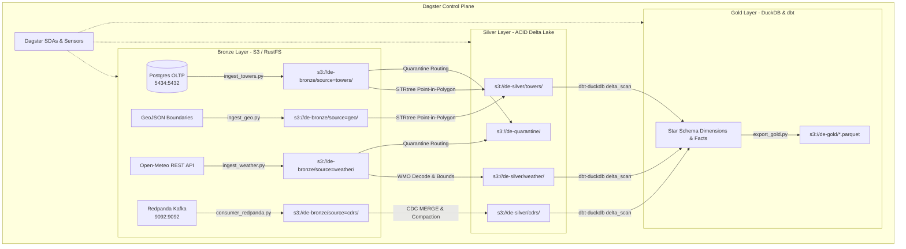

# 📘 SRE Incident Response Runbook & DataOps Standard Operating Procedures (SOP)
## Uganda Mobile Network Quality Intelligence Platform ($0 Lakehouse Stack)

---

## 1. Executive Architecture Overview



---

## 2. Incident Classification & Service Level Objectives (SLOs)

| Severity | Definition | Target MTTA | Target MTTR | Escalation / Response |
| :--- | :--- | :--- | :--- | :--- |
| **SEV-1 (Critical)** | Data loss, lakehouse corruption, S3 offline, or streaming CDC MERGE failure. | $< 15$ mins | $< 1$ hour | On-call Data SRE; immediate rollback via Delta Time Travel. |
| **SEV-2 (High)** | Data contract breach exceeding 15% quarantine threshold, sensor stall, or dbt test failure. | $< 30$ mins | $< 4$ hours | Data Engineer on-call; check upstream source schema changes. |
| **SEV-3 (Medium)** | Weather REST API rate-limit delays (HTTP 429), partial district retry, or single tower quarantine. | $< 2$ hours | $< 24$ hours | Handled automatically by exponential backoff; reviewed in morning triage. |

---

## 3. Incident Troubleshooting & Triage Playbooks

### Playbook 001: Port 9000 / RustFS Host Collision (S3 Unreachable)
* **Symptom:** Ingestion or Delta-RS throws `EndpointConnectionError: Could not connect to the endpoint URL: http://localhost:9000`. RustFS container is restarting or failing to bind port 9000.
* **Root Cause:** An orphaned host process (e.g. background python HTTP server, local web service) occupied host port 9000.
* **Resolution SOP:**
  1. Identify the owning PID:
     ```powershell
     Get-NetTCPConnection -LocalPort 9000 | Select-Object OwningProcess, State
     ```
  2. Terminate the rogue process:
     ```powershell
     Stop-Process -Id <PID> -Force
     ```
  3. Restart the RustFS S3 container:
     ```powershell
     docker compose up -d rustfs
     ```
  4. Verify health:
     ```powershell
     curl -I http://localhost:9000/minio/health/live
     ```

---

### Playbook 002: RustFS S3 "Unclean Shutdown" Lock
* **Symptom:** RustFS logs `Unclean shutdown detected; aborting startup to prevent transaction corruption`.
* **Root Cause:** Container was hard-killed without cleanly unmounting local volume blocks.
* **Resolution SOP:**
  1. Inspect volume lock marker:
     ```powershell
     docker compose stop rustfs
     ```
  2. Clear lock file (if metadata is confirmed intact):
     ```powershell
     docker run --rm -v "01_mobile_network_quality_rustfs_data:/data" alpine rm -f /data/.rustfs.sys/unclean-shutdown
     ```
  3. Start RustFS:
     ```powershell
     docker compose up -d rustfs
     ```

---

### Playbook 003: Postgres Sequence Exhaustion / Burn on Aborted ETL
* **Symptom:** OLTP `BIGSERIAL` primary key jumps by tens of thousands, or unique key collision on `(radio, mcc, net, area, cell)`.
* **Root Cause:** A failed `COPY` statement in Postgres burns sequence counter values even when aborted.
* **Resolution SOP:**
  1. Truncate table and restart identity:
     ```sql
     TRUNCATE TABLE oltp_tower_inventory RESTART IDENTITY;
     ```
  2. Reload cleanly via unconstrained staging table:
     ```sql
     INSERT INTO oltp_tower_inventory (radio, mcc, net, area, cell, unit, lon, lat, range, samples, changeable, created, updated, average_signal)
     SELECT DISTINCT ON (radio, mcc, net, area, cell)
         radio, mcc, net, area, cell, unit, lon, lat, range, samples, changeable, created, updated, average_signal
     FROM stg_tower_inventory_raw;
     ```

---

### Playbook 004: DuckDB DeltaKernel AWS IMDSv2 Probe Timeout
* **Symptom:** `dbt run` hangs for 8 seconds and throws `Error performing PUT http://169.254.169.254/latest/api/token: Error interacting with object store`.
* **Root Cause:** Legacy DuckDB `settings: {s3_endpoint: ...}` is ignored by the modern DeltaKernel extension, prompting an AWS EC2 instance metadata query.
* **Resolution SOP:**
  1. Open `gold/profiles.yml`.
  2. Ensure the modern `secrets:` block is configured with `url_style: path`:
     ```yaml
     secrets:
       - type: s3
         key_id: "{{ env_var('MINIO_ROOT_USER', 'admin') }}"
         secret: "{{ env_var('MINIO_ROOT_PASSWORD', 'password123') }}"
         endpoint: "localhost:9000"
         use_ssl: false
         url_style: path
     ```

---

### Playbook 005: Referential Integrity Violation on Quarantined Dimensions
* **Symptom:** `dbt test` fails on `relationships_fct_cdr_events_tower_id__tower_id__ref_dim_towers_`.
* **Root Cause:** Legitimate call events occurred on towers outside the administrative borders of Uganda, which were quarantined during Silver spatial join.
* **Resolution SOP (Kimball Unknown Member Pattern):**
  1. Ensure `models/marts/dim_towers.sql` includes the default `-1` record:
     ```sql
     SELECT -1 AS tower_id, 'UNKNOWN' AS radio_type, 'Unknown Operator' AS operator_name, ...
     ```
  2. In `models/marts/fct_cdr_events.sql`, coalesce the foreign key:
     ```sql
     COALESCE(t.tower_id, -1) AS tower_id
     ```

---

### Playbook 006: Delta Lake Time Travel Emergency Rollback
* **Symptom:** Corrupt micro-batch or accidental deletion committed to `s3://de-silver/cdrs`.
* **Root Cause:** Bad upstream streaming events escaped validation.
* **Resolution SOP:**
  1. Inspect table commit history:
     ```python
     import deltalake
     dt = deltalake.DeltaTable("s3://de-silver/cdrs", storage_options=STORAGE_OPTIONS)
     for commit in dt.history():
         print(commit["version"], commit["timestamp"], commit["operation"])
     ```
  2. Query clean snapshot at previous known good version (e.g. Version 2):
     ```python
     dt_good = deltalake.DeltaTable("s3://de-silver/cdrs", version=2, storage_options=STORAGE_OPTIONS)
     clean_table = dt_good.to_pyarrow_table()
     ```
  3. Overwrite table back to clean state:
     ```python
     deltalake.write_deltalake("s3://de-silver/cdrs", clean_table, mode="overwrite", storage_options=STORAGE_OPTIONS)
     ```

---

## 4. Routine Maintenance Procedures

### A. Nightly Batch Pipeline Run
```powershell
$env:DAGSTER_HOME="c:\Data-Eng\telecom\01_mobile_network_quality\.dagster_home"
$env:PYTHONPATH="c:\Data-Eng\telecom\01_mobile_network_quality"
.\venv\Scripts\dagster job execute -j telecom_full_pipeline_job -f orchestration/definitions.py
```

### B. Launching the Dagster UI Dashboard
```powershell
$env:DAGSTER_HOME="c:\Data-Eng\telecom\01_mobile_network_quality\.dagster_home"
$env:PYTHONPATH="c:\Data-Eng\telecom\01_mobile_network_quality"
.\venv\Scripts\dagster dev -f orchestration/definitions.py -p 3000
```
*Access UI at:* `http://localhost:3000`

### C. Running Automated Hardening & Regression Tests
```powershell
.\venv\Scripts\pytest -v tests/test_hardening_scenarios.py
```

### D. Running Analytics Mart Tests
```powershell
cd gold
..\venv\Scripts\dbt.exe test --profiles-dir .
cd ..
```

---

## 5. DataOps Git Workflow & Branch Promotion Procedures (Push SOP)

Following [`pipeline_blueprint/step_08_orchestration_and_devops.md`](../../pipeline_blueprint/step_08_orchestration_and_devops.md), the repository uses a **2-tier branching model (`main` + `develop`)** with short-lived feature branches:

```
feature/my-feature ──► [Commit] ──► [PR / Merge] ──► develop ──► [Release PR] ──► main (CI/CD)
```

### Protocol 001: Daily Development on a Feature Branch
Always branch off the latest `develop`:

```powershell
# 1. Ensure develop is up to date
git checkout develop
git pull origin develop

# 2. Create your isolated feature branch
git checkout -b feature/<feature-name>

# 3. Make changes, run local tests, then stage and commit with Conventional Commits
git status
git add <specific-files>
git commit -m "feat(<scope>): descriptive summary of change"

# 4. Push feature branch to GitHub
git push -u origin feature/<feature-name>
```

### Protocol 002: Merging Feature into `develop`
Once verified locally:

```powershell
# Option A: Via GitHub Web Pull Request (Recommended for CI checks)
# Open PR from feature/<feature-name> into develop on GitHub.

# Option B: Local Fast-Forward Merge
git checkout develop
git merge feature/<feature-name>
git push origin develop

# Clean up local feature branch
git branch -d feature/<feature-name>
```

### Protocol 003: Promoting `develop` to Production `main`
When a milestone or phase is complete and ready for production release:

```powershell
# 1. Ensure both branches are synchronized locally
git checkout develop
git pull origin develop
git checkout main
git pull origin main

# 2. Merge develop into main
git merge develop

# 3. Push to production main (triggers GitHub Actions CI/CD)
git push origin main

# 4. Return to develop for daily work
git checkout develop
```

> [!IMPORTANT]
> **Pre-Push Safety Rule:** Never commit secrets (`.env`), database binaries (`*.duckdb`, `*.db`), or large raw datasets (`data/*.geojson`, `data/*.csv`). Always verify `git status` before `git commit`.

